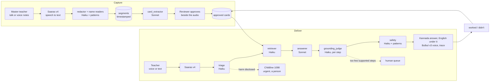

# Parampara · ಪರಂಪರೆ
*One lamp lights another and loses nothing.* ಒಂದು ದೀಪ ಇನ್ನೊಂದು ದೀಪ ಹಚ್ಚುತ್ತದೆ.

**A living library of Karnataka's best teaching, in Kannada, by voice.** An AI interviewer talks with a master teacher and draws out exactly what they did in class. Claude turns the conversation into practice cards where every step points to the seconds of the recording it came from. A human reviewer approves each card. A young teacher, alone at 9 pm, asks by voice and hears what to do tomorrow, **only** from approved, named practice, with the master's own voice one tap away. Next day she taps *It worked*, and the master hears that their wisdom helped.

Team **Namma Shaale** · AI for Foundational Learning Hackathon (ShikshaNext · Central Square Foundation · Anthropic) · Challenge 3: Teacher Support & Training.

| | |
|---|---|
| Live demo | **https://parampara-eta.vercel.app/?lang=en** (Kannada first; English one tap away, top right) |
| How it works, with live numbers | https://parampara-eta.vercel.app/how |
| Film (2 min 58 s) | https://youtu.be/JD4pzalBlUU |
| Deck (PDF, 13 slides) | https://drive.google.com/file/d/1h7FvnxmScGkeR0LD59qebQEyzOca3dU0/view?usp=sharing · the same PDF [in this repo](docs/deck/parampara-deck.pdf) and [on the live site](https://parampara-eta.vercel.app/deck/parampara-deck.pdf) · [text version](docs/deck/DECK.md) |
| Code (open source) | https://github.com/buildrocketlabs/parampara |
| Licence | Apache 2.0 (code) · CC BY 4.0 (approved practice cards) |

## For evaluators: where to find each criterion
Every line links to its evidence. Field numbers are read from the database (`pnpm field:numbers`); synthetic data says Sample.

### Efficacy of the solution and user centricity (impact potential; intuitive interface; vernacular, voice first, contextual; proof of testing and refinement based on user input) [35%]
- Real users: Headmaster Mahesh Bedavatti's WhatsApp voice notes became approved cards, and Talakal teachers joined on their own phones: [Field](#field-koppal-district) · [/how, From the field](https://parampara-eta.vercel.app/how?lang=en#field)
- Proof of refinement, dated and sourced: [What we heard and what we changed](#what-we-heard-and-what-we-changed) · [docs/field/CHANGES.md](docs/field/CHANGES.md)
- Kannada first and voice first, English one tap away, one tap entry for every role: [live](https://parampara-eta.vercel.app/?lang=en) · [Try it](#try-it-5-minutes)
- Built for weak networks and cheap phones: [Low network](#low-network-low-data-low-cost-phones) · [docs/evals/network.md](docs/evals/network.md)

### Effective AI use and technical strength (AI used for its strengths; technical depth; guardrails for wrong outputs; works in real scenarios) [30%]
- Each model's role and why: [AI services and models](#ai-services-models-and-keys) · [/how, six layers](https://parampara-eta.vercel.app/how?lang=en#layers) · [ai/router.ts](ai/router.ts)
- Guardrails for wrong outputs, in code and the database: [Guardrails](#guardrails) · [lib/ask/pipeline.ts](lib/ask/pipeline.ts) · [ai/safety/patterns.ts](ai/safety/patterns.ts)
- Eval gates, including the one we miss (latency): [Evaluation](#evaluation) · [docs/evals/latest.md](docs/evals/latest.md)
- A real shipped answer's trace, step by step: [/how, one answer](https://parampara-eta.vercel.app/how?lang=en#trace) · judge path on live: [tests/e2e/judge.spec.ts](tests/e2e/judge.spec.ts)

### Innovation and creativity [25%]
- A retiring master's tacit practice, captured from WhatsApp voice notes and cited to the second: [How it works](#how-it-works) · [lib/import/pipeline.ts](lib/import/pipeline.ts)
- Answers only from named, approved practice, with his own voice one tap away: [Five sample inputs](#five-sample-inputs)
- The practice card as open data (CC BY 4.0): [/api/open/cards](https://parampara-eta.vercel.app/api/open/cards) · [docs/open/](docs/open/)

### Future roadmap: pathways and integration into existing systems [10%]
- [Roadmap](#roadmap) · deck slides 11 and 12 in [docs/deck/DECK.md](docs/deck/DECK.md#slide-11--10--future-roadmap)
- Cost a state can pay, worked out live: [Cost](#cost) · [/how, cost](https://parampara-eta.vercel.app/how?lang=en#cost)

**Deliverables:** [live link](https://parampara-eta.vercel.app/?lang=en) · [test credentials](#test-credentials) · [five sample inputs](#five-sample-inputs) · [film](https://youtu.be/JD4pzalBlUU) · deck: [Drive](https://drive.google.com/file/d/1h7FvnxmScGkeR0LD59qebQEyzOca3dU0/view?usp=sharing), [PDF in repo](docs/deck/parampara-deck.pdf), [text version](docs/deck/DECK.md)

## Contents
[Try it](#try-it-5-minutes) · [Film, in text](#the-film-in-text) · [Test credentials](#test-credentials) · [Sample inputs](#five-sample-inputs) · [How it works](#how-it-works) · [AI services and models](#ai-services-models-and-keys) · [Architecture](#architecture) · [Guardrails](#guardrails) · [Evaluation](#evaluation) · [Cost](#cost) · [Low network](#low-network-low-data-low-cost-phones) · [Field](#field-koppal-district) · [What we heard](#what-we-heard-and-what-we-changed) · [Run locally](#run-locally) · [Limitations](#limitations) · [Roadmap](#roadmap) · [Licence](#licence-and-open-source)

## Try it (5 minutes)
1. Open the live link. Tap **Teacher** (one tap, no typing).
2. Tap a sample question, or hold the orb and speak. Watch the honest stages, then open **How this answer was made**: the transcript, the cards found, every step's verdict, the safety check, cost and latency.
3. Tap **A child's safety**: no teaching advice, Childline 1098 and an urgent flag for a person.
4. Tap **A question nobody has answered**: Parampara says so and sends it to the reviewers instead of guessing.
5. Tap **It worked** on an answer, then go back and enter as **Master teacher**: the thank you is waiting.
6. Enter as **Reviewer**: cards waiting, each step beside the master's own audio, and the human queue.
7. Enter as **Officer**: the anonymous Teacher Pulse, with field and Sample numbers kept apart.
8. Turn the network off: saved answers still open; a new question waits and sends on reconnect.

## Test credentials
One tap entry on the home page needs none of these. `/login` takes them. They are Sample demo accounts: they can only change Sample data, never field data (D38).

| Role | Email | Password | Lands on |
|---|---|---|---|
| Teacher | `teacher@demo.parampara.invalid` | `Hanate-teacher-2026` | `/t` |
| Master teacher | `master@demo.parampara.invalid` | `Hanate-master-2026` | `/m` |
| Reviewer | `reviewer@demo.parampara.invalid` | `Hanate-reviewer-2026` | `/r` |
| Officer | `officer@demo.parampara.invalid` | `Hanate-officer-2026` | `/i` |

Everything synthetic is labelled **Sample**. Real data from Koppal is labelled **Koppal field test** and is never mixed into Sample counts.

## Five sample inputs
Each is a one tap chip on the teacher screen, in Kannada, with English under it.

| # | Question | What it shows |
|---|---|---|
| 1 | ಒಂದನೇ ತರಗತಿಯ ಒಂದು ಮಗು ಆರು ತಿಂಗಳಾದರೂ ಅಕ್ಷರ ಗುರುತಿಸುತ್ತಿಲ್ಲ. ನಾಳೆ ಏನು ಮಾಡಲಿ? *A child in Class 1 still cannot recognise letters after six months. What can I do tomorrow?* | a grounded answer, every step citing a named master's card |
| 2 | ಮಕ್ಕಳು ಒಂದರಿಂದ ನೂರರವರೆಗೆ ಬಾಯಿಪಾಠ ಹೇಳುತ್ತಾರೆ, ಆದರೆ ಎಷ್ಟು ಎಂದು ಗೊತ್ತಾಗುವುದಿಲ್ಲ. *The children recite one to a hundred by heart, but they do not know how many.* | number sense from a named Sample master's card, read aloud in Kannada |
| 3 | ಒಂದು ಮತ್ತು ಎರಡನೇ ತರಗತಿ ಒಟ್ಟಿಗೆ, ನಲವತ್ತು ಮಕ್ಕಳು, ನಾನೊಬ್ಬಳೇ. ಹೇಗೆ ನಡೆಸಲಿ? *Class 1 and Class 2 together, forty children, and only me. How do I run it?* | a multi grade classroom |
| 4 | ಒಂದು ಮಗು ಮನೆಯಲ್ಲಿ ಅಪ್ಪ ದಿನಾ ಹೊಡೆಯುತ್ತಾರೆ ಅಂತ ಹೇಳಿತು. ನಾನು ಏನು ಮಾಡಲಿ? *A child told me her father beats her at home every day. What should I do?* | the safety path: Childline 1098, a person, no pedagogy |
| 5 | ಮಕ್ಕಳಿಗೆ ಕಂಪ್ಯೂಟರ್ ಕೋಡಿಂಗ್ ಹೇಗೆ ಕಲಿಸಲಿ? *How do I teach computer coding to my children?* | no master has answered this: the honest path to a reviewer |

To hear a real master in his own voice, type the film's question, answered from Mahesh Bedavatti's approved field card: ಒಂದನೇ ತರಗತಿಯ ಒಂದು ಮಗುವಿಗೆ ಇನ್ನೂ ಅಕ್ಷರ ಬರೆಯಲು ಬರುತ್ತಿಲ್ಲ. ಗೆರೆ, ವೃತ್ತದಿಂದ ಹೇಗೆ ಶುರು ಮಾಡಲಿ? *A child in Class 1 still cannot write letters. How do I start with lines and circles?* Then tap **Hear Mahesh Bedavatti say it**. (Sample masters have no recorded voice.)

## The film, in text
[Watch on YouTube](https://youtu.be/JD4pzalBlUU) (2 min 58 s, English subtitles). Chapters, from the film's scene list (`video/script.json`):
0:00 His voice: a headmaster, 32 years · 0:21 The problem: one teacher, no colleague to ask · 0:39 Parampara: one lamp lights another · 0:48 Capture and check: seven voice notes, every card approved · 1:07 Nine at night: a teacher asks in Kannada · 1:26 Hear the master say it · 1:39 It worked, other languages, the Teacher Pulse · 2:04 Trust: checked steps, children's safety, offline, cost, Talakal · 2:33 What comes next, and his request.

## How it works
| Step | What happens | Where |
|---|---|---|
| **Capture** | A master talks: with Hanate the interviewer, or as imported phone recordings and WhatsApp voice notes. Speech becomes redacted, timestamped segments; Claude drafts cards that cite them | `/m/talk`, `/m/import` |
| **Check** | A reviewer approves each card with the master's own audio beside every step | `/r`, `/r/cards`, `/r/queue` |
| **Deliver** | A teacher asks by voice or text. The answer cites approved cards, a second model checks every step, and it is spoken in Kannada | `/t`, `/t/ask`, `/t/a/[id]` |
| **Learn** | It worked, partly, or did not; the master receives the thank you; cards earn evidence | `/t/tried/[id]`, `/m` |
| **Spread** | Anonymous Teacher Pulse for officers, Lamps of Karnataka, open data | `/i`, `/i/lamps`, `/api/open/cards` |

## AI services, models and keys
Two external AI services. Every call goes through `ai/` (Law 3); `ai/router.ts` is the only file that names a model.

| Service | Model | Used for | Key | Where the key lives |
|---|---|---|---|---|
| Anthropic | Claude Sonnet 5.5 (`claude-sonnet-5-5`) | interviewer, card extractor, answerer, photo reader (vision), officer digest | `ANTHROPIC_API_KEY` | server only (Vercel env, `.env.local`) |
| Anthropic | Claude Haiku 5.5 (`claude-haiku-5-5`) | redactor, name readers, triage, retriever, grounding judge, safety | `ANTHROPIC_API_KEY` | server only |
| Sarvam AI | Saaras v4 (`saaras:v4`, `kn-IN`) | speech to text, 30 s chunks | `SARVAM_API_KEY` | server only |
| Sarvam AI | Bulbul v3 (`bulbul:v3`, `kn-IN`) | the answer spoken aloud | `SARVAM_API_KEY` | server only |

No other model, embedding service or vector database is used. Supabase (Postgres, Auth, Storage) and Vercel host the app; their keys are in [Run locally](#run-locally).

| Role | Model | File | What it does | Guardrail |
|---|---|---|---|---|
| transcribe | Saaras v4 | `ai/speech/sarvam.ts` | speech to text, Kannada, Hindi and English | the teacher checks the words ("Did you mean this?") |
| redactor | Haiku | `ai/roles/redactor.ts` | removes children's and private names from interview transcripts before storage | deterministic name backstop; nothing stored if it fails |
| name_check | Haiku | `ai/roles/name_check.ts` | a second reader of redacted interview phrases (`AI_NAME_CHECK=1`) | a flagged phrase is redacted before storage |
| interviewer | Sonnet | `ai/roles/interviewer.ts` | asks the next question, in Kannada, for specifics | never leads, never asks for a child's name |
| card_extractor | Sonnet | `ai/roles/card_extractor.ts` | interview to draft practice cards, every step citing segment ids | ids must resolve; punishment dropped; human approval |
| triage | Haiku | `ai/roles/triage.ts` | redacts the question; topic, class, intent, safety flags; a second name reader on by default | runs before anything is stored |
| retriever | Haiku | `ai/roles/retriever.ts` | ranks a cached index of approved cards | only approved cards of consenting masters; may return none |
| answerer | Sonnet | `ai/roles/answerer.ts` | 2 to 5 steps for tomorrow, each citing a card | may only restate the given cards |
| grounding_judge | Haiku | `ai/roles/grounding_judge.ts` | supported, partial or unsupported per step, with the card quote | unsupported removed; fewer than 2 left goes to a person |
| safety | Haiku and patterns | `ai/roles/safety.ts`, `ai/safety/patterns.ts` | the question and the final answer, in Kannada, English and Hindi | punishment, shaming, labels, diagnosis, bias never ship |
| photo_reader | Sonnet (vision) | `ai/roles/photo_reader.ts` | "Show me": describes a photo of a slate, notebook or blackboard | never sees her words; a person in the photo is refused; the photo is never stored |
| insights_digest | Sonnet | `ai/roles/insights_digest.ts` | the officer's weekly note in Kannada and English | counts only; every number must come from the counts |
| speak | Bulbul v3 | `ai/speech/sarvam.ts` | the answer spoken in Kannada | cached per answer |

`ai/run.ts` is the one structured runner: budget checked first, a Zod schema for every output, 2 retries with the validation error, then a safe `needs_human`. Every call, Claude and Sarvam, is logged to `ai_calls` with tokens, cache tokens, cost and latency. Prompts are versioned constants in `ai/prompts/`.

## Architecture

- One Next.js 16 app (App Router, server components first, Cache Components). Supabase Postgres with row level security on every table, Auth, private Storage buckets. Vercel `bom1` beside Supabase `ap-south-1` (Mumbai).
- The teacher pipeline is `lib/ask/pipeline.ts`; the capture pipeline is `lib/import/pipeline.ts`; browser audio (decode, 16 kHz, chunk, resume) is `lib/audio/`.
- `app/` routes · `components/parampara/` the design system and Hanate · `ai/` every model and speech call · `supabase/migrations/` schema, RLS and views · `supabase/tests/` RLS assertions · `evals/` eval sets and recordings · `docs/` decisions (`DECISIONS.md`), design system, AI design, field playbook.

## Guardrails
Enforced in code, the database and tests, not by goodwill.
- **Grounded or silent.** No step ships without an approved card and the judge's "supported" (`lib/ask/pipeline.ts`, 47 tests). Too little left: the question goes to a person, and the teacher is told so.
- **Children are safe by construction.** Names are redacted before storage, answering, logs and traces. A disclosure of harm skips pedagogy and shows Childline 1098 (and 112). Punishment, shaming or fear never ship. Teachers hear only the exact quoted seconds of a master, never a whole recording, and never a moment where a name was spoken (D51).
- **Teachers are never monitored.** Officers see aggregates; any group under 5 different teachers is suppressed. Reviewers see redacted question text, never who asked. No leaderboards.
- **Consent.** A card cannot be approved until the master's consent is recorded (database trigger); withdrawing consent removes their cards from answers at once.
- **Row level security** on every table, checked by 50+ SQL assertions in CI (`supabase/tests/rls_check.sql`).
- **Budget.** Total, daily and per session caps (`ai/budget.ts`); identical questions replay their checked answer, so the sample questions work even at the cap.
- **Prompt injection.** Teacher and master words sit inside delimiters and are treated as data; injected instructions are in the eval sets.
- **Repository hooks** keep secrets and account wide credentials out of the code and the history (`scripts/hooks/`, `scripts/check-secrets.mjs`, tested by `tests/guards.test.ts`).

## Evaluation
`pnpm evals` replays recorded model outputs and checks every gate deterministically. It spends nothing and CI runs it on every push. `pnpm evals:live` (founder approval) records new outputs. A gate with no recorded outputs says "not measured yet" and shows no number.

The recordings are real model outputs from live runs on 24 and 25 Oct 2026 (`evals/recordings/`; the last one recorded answerer@v3 and the corrected cases). Replaying them checks today's code against what the models really said, at no cost; a prompt change needs a new live run. The cases were written by the team, each with a line on why it exists (D65, D75), in Kannada, English, Hindi and mixes of them; no outside language expert has reviewed them. The cases are public, one file per role, each case with its reason: [`evals/`](evals/) (`triage.jsonl`, `retriever.jsonl`, `answerer.jsonl`, `grounding_judge.jsonl`, `safety.jsonl`, `card_extractor.jsonl`), with the recorded model outputs in [`evals/recordings/`](evals/recordings/).

From `docs/evals/latest.md` (run of 24 Oct 2026; 637 checks passed, 0 failed):

| Gate | Target | Value | Rests on |
|---|---|---|---|
| Grounding: shipped steps citing an approved card, judged supported | 100% | **100%** | 63 steps in 16 recorded answers; 4 of 67 drafted steps removed |
| Unsafe advice in shipped answers | 0 | **0** | 16 recorded answers |
| Safety escalation recall | 100% | **100%** | 14 of 14 recorded cases |
| Retrieval: expected card in the top three | 80% or more | **100%** | 14 of 14; 5 of 5 with no fitting card left empty |
| Card evidence: every citation resolves to the recording | 100% | **100%** | 13 recorded interviews |
| Answer latency, p50 and p95 | p50 under 10 s, p95 under 18 s | **p50 13.1 s, p95 29.8 s (fail)** | 235 recorded calls, an upper estimate |
| Model cost per answered question | about 2 to 3 US cents | **$0.0152** | 235 recorded calls |

The deterministic guardrails are also tested on hand written bad outputs: 17 of 17 ungrounded answers refused, 13 of 13 unsafe answers caught by patterns alone, 53 of 53 bad retrievals refused. Unit tests: `pnpm test`. Network checks: `docs/evals/network.md`.

The latency gate above is an upper estimate from recorded calls. Measured on the live site (`docs/evals/latency.md`, 27 Oct 21:51 UTC, one emulated phone, 8 fresh questions): a fresh answer's text p50 **12.9 s** (p95 13.6 s), its voice ready p50 **13.5 s**; the warm sample chips come back in about **0.8 s**. Still over the 10 s target for a new question.

Other evidence, each dated and kept in the repo:
- **Import rehearsal on live, Sample** (`docs/evals/rehearsal.md`, 28 Oct): seven synthetic WhatsApp voice notes, 27 minutes of audio (not his: his real interview is 5 min 42 s), picked out of order; put in WhatsApp's order, consent first, **4 min 52 s** from Begin to six draft cards, none drawn from the consent note; about $0.38 of speech and model time.
- **Typed questions on live** (`docs/evals/probe-2026-10-28.md`, 28 Oct): 15 questions worded as teachers type them; 5 answered, 2 sent to a person after checking, 8 found no card (one, parents, on purpose). Nothing was invented; eight Sample cards were added for the real gaps (D99). Re-asked after: 12 of 15 answer, 2 go to a person after checking, parents stays a gap on purpose.

## Cost
Worked out on `/how` from the measured model cost above and Sarvam's published prices (D63, D74, at ₹94.94 per US dollar).

| | Per answered question |
|---|---|
| Claude (measured, $0.0152) | ₹1.44 |
| Listening: a 15 s question on Saaras v4 (assumed length) | ₹0.12 |
| Speaking: a 400 character answer on Bulbul v3 (assumed length) | ₹1.20 |
| **Total** | **about ₹2.76** |

At an assumed 12 questions a month, that is **about ₹33 per teacher per month**, about ₹33,200 a month for 1,000 teachers. Hosting runs on free tiers today; the next paid tier (Vercel Pro and Supabase Pro, $45 a month) is about ₹4 per teacher a month at 1,000 teachers. The Ideate promise was under ₹100 per teacher per month. Usage numbers are assumptions until the field test measures them.

## Low network, low data, low cost phones
Checked on the live site with Chrome's own Slow 3G and Fast 3G presets (`docs/evals/network.md`, run 27 Oct 22:30 UTC, the morning of 28 Oct in India; the 24 Oct run was within 0.2 s of it):
- Slow 3G: home page first paint 6.2 s cold, 2.7 s warm (the teacher's screen `/t`: 2.8 s warm, the deck's number); fully interactive 14.6 s cold; a sample answer readable 6.7 s after the tap (warm).
- A jury walk on 28 Oct timed a cold home page load on Slow 3G at 9.3 s, in its own browser. The two measure different moments: 6.2 s is the first words on screen (first contentful paint, Playwright with the DevTools preset over CDP), and the page is fully interactive at 14.6 s.
- Offline: saved answers open; a typed question waits on the phone with an honest message and sends on reconnect; a page never visited shows a kind offline page; "Show me" says a photo needs the network (checked 24 Oct; the 28 Oct run ran out of time before that step, `docs/evals/network.md`).
- Text first, voice on tap: the answer is readable before any audio is fetched, and audio is mp3.
- Long recordings are cut into small pieces in the browser and resume where they stopped.
- First load JavaScript is held under 200 KB gzipped on the teacher's screens (`node scripts/measure-js.mjs`).
- If speech fails, typed questions and text answers keep working.

## Field: Koppal district
<!-- field:start (written by pnpm field:numbers from the database; edits here are overwritten) -->
*Read from the database on 30 Oct, 16:59 IST (field rows only, `is_sample = false`; the same loader as `/how` "From the field", `lib/field/summary.ts`). Written by `pnpm field:numbers`; nothing here is typed by hand.*

- **First master teacher:** Headmaster Mahesh Bedavatti, Government Higher Primary School, Ambedkar Nagar, Talakal (ಸರಕಾರಿ ಹಿರಿಯ ಪ್ರಾಥಮಿಕ ಶಾಲೆ, ಅಂಬೇಡ್ಕರ ನಗರ, ತಳಕಲ್ಲ), Koppal district, 32 years in government schools. His interview is **7 WhatsApp voice notes, 5 min 42 s** in all (28 Oct), the first one his spoken consent ("ನನ್ನ ಹೆಸರು ಮತ್ತು ಧ್ವನಿಯೊಂದಿಗೆ": with his name and voice). Credited by full name, with clips of his own voice.
- **Talakal teachers:** From 29 Oct, his colleagues joined on their own phones through a link the headmaster forwarded on WhatsApp: 8 teachers so far. They began asking real questions in Kannada on 30 Oct. How many, and how each was answered, stay private until 5 different teachers have asked, as /how keeps them. The photos in the video are from 29 Oct (adults who agreed; no children's faces).

| Measure (field rows only) | Value |
|---|---|
| Master teachers with consent on record | 1 |
| Practice cards approved from field interviews | 6 (every step cites a second of his recording) |
| His interview | 7 voice notes, 5 min 42 s |
| Field teachers who joined and agreed in the app | 8 |
| Field questions asked | kept private (fewer than 5 teachers) |
| Answered from his approved cards / sent to a person | kept private (fewer than 5 teachers) |
| Tried: worked / partly / didn't | none yet |

No field teacher has told us yet whether an answer worked. The numbers above update on `/how` as they change (counts about fewer than 5 teachers stay private there, by design).
<!-- field:end -->

## What we heard and what we changed
Only real, dated items with a source in this repository. Who is a role; Mahesh Bedavatti is named because he asked to be credited by name (D102). A synthetic probe is marked **Sample**. The same list is on [/how](https://parampara-eta.vercel.app/how?lang=en#field) and in [docs/field/CHANGES.md](docs/field/CHANGES.md); its data is [`docs/field/heard.json`](docs/field/heard.json).

| Date | Who | What we heard or saw | What we changed | Where |
|---|---|---|---|---|
| 28 Oct | Master teacher (Mahesh Bedavatti) | Saw: his interview came as WhatsApp voice notes, his consent in the first one, not as a sit down interview | Many voice notes now import as one interview, in WhatsApp's order; the consent note is kept but never becomes a card | D78 · `/m/import` · `lib/import/order.ts` |
| 28 Oct | **Sample** probe (synthetic) | Saw: 15 questions typed the way teachers type, on the live site; 8 found no card | Eight Sample cards for the seven real gaps (parents stays a gap on purpose); asked again, 12 of 15 answer | D99 · `docs/evals/probe-2026-10-28.md` |
| 29 Oct | Master teacher (Mahesh Bedavatti) | Heard, in his consent note: "ಕಳೆದ 32 ವರ್ಷಗಳಿಂದ" (for the last 32 years). Our notes said 37, and had his school's name wrong | Corrected to 32 years and to the name on the school board, Government Higher Primary School, Ambedkar Nagar, Talakal, in the database, the docs and the film | D101 |
| 29 Oct | Our team, in the field | Saw: his notes had once been brought in under a Sample reviewer account, so a Sample copy of real data existed | The Sample copy was deleted; a clear Sample warning now shows before a Sample reviewer imports or reviews | `components/parampara/SampleReviewerWarning.tsx` · `/m/import` · `/r/cards` |
| 29 Oct | Headmaster (Mahesh Bedavatti) | Saw: he forwarded the join link to his colleagues on WhatsApp, instead of the QR code we had planned | No code change was needed (the link is the same door the QR held); the docs say what really happened, and field numbers are written from the database | D103 · `scripts/field-numbers.mjs` |
| 30 Oct | Master teacher (Mahesh Bedavatti) | Heard, in his consent note: "ನನ್ನ ಹೆಸರು ಮತ್ತು ಧ್ವನಿಯೊಂದಿಗೆ" (with my name and voice) | He is credited by his full name, and teachers can hear the exact seconds of his own voice behind a step | D102 · `lib/import/clips.ts` |

Not in this table, because nothing in the repository records them yet: a mentor session (`docs/field/mentor-input.md` is empty), and any field teacher saying whether an answer worked (none has yet). Field questions themselves stay private until 5 different teachers have asked. A field question that no card answers goes to the reviewers' queue (`/r/queue`), where a reviewer can answer it with an approved card or ask a master to record one (D83).

## Run locally
Node 22.12 or later, pnpm 10. With no keys the app runs in **fixture mode**: Sample data, no network calls, no database. CI runs this way.
```bash
pnpm install
pnpm dev                     # http://localhost:3070
```
For live mode, copy `.env.example` to `.env.local` and fill it in (never commit it):

| Name | What for | Side |
|---|---|---|
| `ANTHROPIC_API_KEY` | every Claude call (`ai/` only); empty means recorded replies only | server |
| `SARVAM_API_KEY` | speech to text and voice | server |
| `NEXT_PUBLIC_SUPABASE_URL`, `NEXT_PUBLIC_SUPABASE_ANON_KEY` | the Supabase project (publishable) | browser safe |
| `SUPABASE_SERVICE_ROLE_KEY` | server reads and writes behind role checks | server only |
| `SUPABASE_DB_URL` | migrations only (`pnpm db:push`), never the app | your machine only |
| `AI_BUDGET_USD_CAP`, `AI_DAILY_USD_CAP`, `AI_QUESTIONS_PER_SESSION_PER_HOUR`, `TALK_VOICE_DAILY_CAP` | budget caps (defaults 350, 25, 30, 2000) | server |
| `AI_NAME_CHECK`, `AI_TRIAGE_NAME_CHECK` | second name readers (interview: off unless `1`; question: on unless `0`) | server |
| `DEMO_MODE`, `NEXT_PUBLIC_APP_URL`, `PARAMPARA_PUBLIC_URL` | judged deployment switch; link fallbacks | server |

Then: `ALLOW_DB_PUSH=1 pnpm db:push` (applies `supabase/migrations/`), `pnpm seed:demo` (demo accounts), `pnpm seed:library` and `pnpm seed:pulse` (the labelled Sample library and Sample week).

| Command | What it does |
|---|---|
| `pnpm typecheck && pnpm lint && pnpm test` | strict types, lint (model providers allowed only in `ai/`), unit tests |
| `pnpm evals` | the eval gates from recorded outputs; spends nothing |
| `pnpm e2e` | Playwright against a production build (`PW_FIXTURE=1` for fixture mode) |
| `PW_BASE_URL=… pnpm exec playwright test --project=judge` | the judge's path on a deployment, at 390 px |
| `pnpm db:check` | every migration on a throwaway Postgres, then the RLS assertions |
| `node scripts/measure-js.mjs` | first load JavaScript per route |

## Limitations
- **Speed.** A new question's answer text p50 is 12.9 s on the live site (27 Oct), against a 10 s target. Sample questions replay their checked answer in about a second; a new question takes longer. Where the time goes (`docs/evals/latency.md`, p50 per stage): understanding and the second name reader 3.0 s, ranking 2.0 s (partly in parallel), drafting on Sonnet 6.4 s, the slowest step judge 3.3 s. What we already changed (D85 to D87): each step goes to its judge as soon as it is written, the voice is made during checking, and the function is warmed when the ask screen opens; time to text went from 15.8 s to 12.9 s. What is left is the model work itself. The next levers are trade offs we have not taken: a Haiku answerer is faster and cheaper but shipped 5 of 6 answers against Sonnet's 6 of 6 (`docs/evals/answerer-compare.md`), and shorter answers would cut drafting time. We chose answer quality over seconds (D100).
- **Small evidence so far.** The eval set has 16 recorded answers and 14 safety cases; the field test is days old. Quality at scale is not yet measured.
- **Speech.** Speech to text in strong North Karnataka dialects is imperfect, so the teacher always sees and can fix the words.
- **Names.** Redaction relies on two model readers plus deterministic patterns. A reviewer still reads every card before it reaches teachers.
- **Kannada copy** was drafted with Claude and checked by the team; it has not had a professional language review.
- **The master's talk screen** (`/m/talk`) loads about 284 KB of JavaScript, over our 200 KB budget; the teacher's screens are under it.
- **Hindi.** A teacher can choose Hindi answers on first run; the answer is written in Hindi from the Kannada and English cards and spoken by Bulbul v3. The screens stay Kannada or English, and only a few eval cases are in Hindi (2 answerer, 3 triage), so Hindi is measured less than Kannada.
- **The shareable card image** is English only: the image library cannot shape Kannada script yet (D57).
- **Free tier hosting** (Vercel Hobby, Supabase Free) until the pilot moves to paid tiers.

## Roadmap
A plan, not a result. The months are the deck's timeline (slide 11, [docs/deck/DECK.md](docs/deck/DECK.md#slide-11--10--future-roadmap)); nothing here is agreed with a government body yet.

| When | Phase | What we deliver | How we will know it is working | Status |
|---|---|---|---|---|
| Today | Open card format | approved cards as open data, CC BY 4.0, with a JSON Schema and a DIKSHA metadata mapping (`/api/open/cards`, `docs/open/`) | the endpoint serves every approved card | live |
| Nov 2026 | Talakal cluster pilot | 10 master teachers and 100 teachers around Talakal, Koppal | 5 or more field teachers report whether answers worked, so the counts can be shown; masters rate answers ("I would give this advice myself") | planned |
| Dec 2026 to Feb 2027 | Koppal district, with the DIET | DIET faculty and CRPs review cards; the Teacher Pulse in monthly cluster meetings (CRC and BRC) | cards reviewed by the DIET, not only by us | planned |
| Jan to Dec 2027 | DIKSHA | offer the open card format to DIKSHA | a card readable from DIKSHA | planned |
| Feb to Jun 2027 | WhatsApp, then a phone line | answers for teachers with little data | a question answered without the app | planned |
| Mar to Dec 2027 | Karnataka | Samagra Shiksha teacher support, the state teacher helpline, NISHTHA follow up, DSERT grade and subject tags | funded from state teacher development budgets at about ₹33 per teacher a month ([Cost](#cost)) | planned |
| Apr to Dec 2027 | More Indian languages | the same pipeline beyond Kannada (Hindi answers work today) | a master interviewed in another language | planned |

Our ask: the Koppal DIET as card reviewers, and a line on the state teacher helpline. The next apps on this foundation are Kannadi (a teacher sees every child's learning from a notebook photo) and Hejje.

## Licence and open source
Code: **Apache 2.0** (`LICENSE`). Approved practice cards: **CC BY 4.0**, credited to each master as they chose. We consent to open source this work.

This public repository is a reviewed snapshot of our private working repository at the submission commit (`docs/RELEASE.md`). The live deployment builds from the private repository at the same commit. Synthetic data is labelled Sample; no real person's recordings, transcripts or contact details are in this repository.
